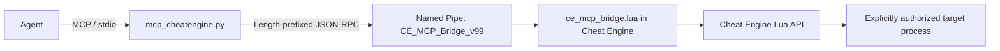

# Cheat Engine + AI Agent: Research, Local Verification, and Method Catalog

> **Research date:** 2026-08-31  
> **Scope:** This guide is for software you own, an offline lab, a deliberately vulnerable/demo application, or a process for which you have explicit authorization to inspect and modify. It does **not** provide workflows for multiplayer cheating, bypassing anti-cheat, or evading monitoring/protection.

## 1. Executive summary

The local Cheat Engine MCP bridge is operational and was verified without modifying memory, changing execution state, creating a breakpoint, enabling DBVM/DBK, or loading/reloading scripts.

| Verification item | Observed result |
|---|---|
| Cheat Engine process | `cheatengine-x86_64-SSE4-AVX2.exe`, PID `1104` |
| Cheat Engine window | `Cheat Engine` |
| Named-pipe bridge | `\\.\pipe\CE_MCP_Bridge_v99` responded successfully |
| Bridge version | `12.0.0` |
| Current CE attachment | Cheat Engine is attached to **itself**, PID `1104` |
| Debugger state | Not debugging; debugger interface `none` |
| Bridge-managed breakpoints | `0` |
| Module enumeration | Native enumeration worked; first module is CE at `0x00400000` |
| Read-only memory proof | 16 bytes at `0x00400000` began with valid PE header `4D 5A` (`MZ`) |

The bridge exposes **175 public FastMCP tools**. Static source inspection found matching coverage across:

- `MCP_Server/mcp_cheatengine.py`: **175** `@mcp.tool()` public tools.
- `MCP_Server/ce_mcp_bridge.lua`: **175** canonical handler routes plus **7** Lua-only aliases.
- `AI_Context/MCP_Bridge_Command_Reference.md`: documents the same canonical public surface.

The practical conclusion is that the current machine can safely support an agent’s **read-only inspection and analysis** workflow. It has not been validated against any external target process yet, because the open CE session currently targets CE itself.

---

## 2. Sources used for the research

| Source | Why it matters |
|---|---|
| [Official Cheat Engine Wiki — Main Page](http://wiki.cheatengine.org/index.php?title=Main_Page) | Official index for scans, pointers, AOBs, Lua, Auto Assembler, and tutorials. |
| [Official Cheat Engine Help File](http://wiki.cheatengine.org/index.php?title=Cheat_Engine:Help_File) | Official task-oriented documentation for the user interface, scanning, Memory Viewer, plugins, settings, and tutorials. |
| [Official value-scanning tutorials](http://wiki.cheatengine.org/index.php?title=Tutorials:Finding_values:Integers) and [float tutorial](http://wiki.cheatengine.org/index.php?title=Tutorials:Finding_values:Floats) | Establish the first-scan / controlled-change / next-scan workflow. |
| [Official pointers tutorial](http://wiki.cheatengine.org/index.php?title=Tutorials:Pointers) | Covers the distinction between dynamic addresses and pointer paths. |
| [Official AOB tutorial](http://wiki.cheatengine.org/index.php?title=Tutorials:AOBs) | Covers byte-pattern identification and its use in relocation-resilient analysis. |
| [Official Lua documentation](http://wiki.cheatengine.org/index.php?title=Cheat_Engine:Lua) | Documents CE’s scripting surface. |
| [Official Auto Assembler documentation](http://wiki.cheatengine.org/index.php?title=Cheat_Engine:Auto_Assembler) | Documents assembly scripts and explains that scripts can allocate, alter, or execute code; therefore they must not be automatic agent actions. |
| [Upstream Cheat Engine source repository](https://github.com/cheat-engine/cheat-engine) | Confirms the upstream project and current development source. |
| Local `MCP_Server/mcp_cheatengine.py` and `MCP_Server/ce_mcp_bridge.lua` | Source of truth for the agent bridge’s actual tool names and runtime behavior. |
| Local `AI_Context/MCP_Bridge_Command_Reference.md` | Long-form request/response reference for bridge methods. |

### Key research findings

1. **Use controlled state changes, not broad guessing.** The reliable workflow is: identify the correct value type, capture a known state, deliberately change that state in an authorized test application, then filter results based on the observed transition.
2. **Treat an address as a lead, not a result.** A discovered address must be re-read, checked after a state transition, and then tested across process restarts before being considered stable.
3. **Prefer narrow scope.** Restrict scanning to an authorized process, a known module, appropriate value type, and small result pages. This reduces false positives, latency, and accidental disruption.
4. **Separate observation from mutation.** Reading, disassembly, checksums, and symbol resolution are useful default agent capabilities. Writes, breakpoints, process control, scripting, injection, input simulation, and kernel features must be opt-in and explicitly approved.
5. **Use pointers and AOBs for repeatability.** Pointer paths help recover dynamic data after a restart. Module-scoped AOB signatures help identify code/data locations after layout changes. Both need independent validation and must not be assumed stable merely because they resolve once.
6. **Lua and Auto Assembler are code execution surfaces.** They are powerful, but not safe as unattended automation. In particular, official Auto Assembler documentation notes that syntax checks can execute Lua sections, so even “check-only” content needs review.

---

## 3. What was verified on this machine

### 3.1 Verification safety boundary

The local check deliberately avoided all operations that could alter a target or the CE session:

- No memory writes, allocation, protection changes, copying, mapping, or file-to-memory loading.
- No `evaluate_lua`, Auto Assembler, compilation, injection, or code execution.
- No process attach/switch, process creation, debugger attach, pause/resume, breakpoint creation/removal, DBVM, DBK, CR3, or kernel operations.
- No input automation, window messages, clipboard writes, modal dialogs, table changes, or file writes.
- No reload of `ce_mcp_bridge.lua`. Reloading triggers bridge cleanup and can clear bridge-managed long-lived state.

### 3.2 Read-only calls and results

| Call | Result | Meaning |
|---|---|---|
| `ping` | `success: true`, bridge version `12.0.0` | CE Lua bridge is loaded and the IPC channel is responsive. |
| `get_process_info` | CE process found, with loaded modules | Confirms the bridge has a current attachment. This call refreshes CE’s symbol handler internally, so it is not used as the minimum no-side-effect baseline in future checks. |
| `get_opened_process_id` | PID `1104` | CE is currently attached to its own process. |
| `debug_is_debugging` | `false` | No CE debugger session is active. |
| `debug_get_current_debugger_interface` | `none` | No active debugger interface. |
| `list_breakpoints` | `count: 0` | No bridge-managed breakpoint was present or created. |
| `enum_modules(offset=0, limit=3)` | Success; `71` modules reported | Native module enumeration is working. |
| `read_memory(address=0x00400000, size=16)` | `4D 5A 90 00 03 00 00 00 04 00 00 00 FF FF 00 00` | Read-only access works and the main module begins with the expected `MZ` PE signature. |

### 3.3 Interpretation and limitation

This proves the bridge and its basic inspection methods work **against the currently opened attachment only**. The current attachment is Cheat Engine itself, not an external application. Before analyzing another process, an operator must explicitly confirm that process is in scope and deliberately attach CE to it; an agent should never silently call `open_process`.

`get_process_info` initially reported 50 modules while a later native `enum_modules` call reported 71. Use `enum_modules` for paginated detailed enumeration; treat the two calls as different bridge views rather than relying on their counts being identical.

---

## 4. Recommended effective workflow for an authorized test target

### Phase 0 — Establish scope and a non-mutating baseline

1. Record authorization, target name/PID, intended objective, and whether the task permits only observation or also controlled mutation.
2. Confirm the bridge with `ping`.
3. Confirm CE’s current attachment with `get_opened_process_id`; do not attach or switch processes automatically.
4. Record debugger and breakpoint baseline using `debug_is_debugging`, `debug_get_current_debugger_interface`, and `list_breakpoints`.
5. Enumerate a small page of modules with `enum_modules`, then retain the main module base address for later read-only inspection.

### Phase 1 — Discover a controlled value (authorized lab/demo only)

1. Create or use a known value in an authorized test application, such as a locally built counter or a sample program field.
2. Pick the most likely type (`byte`, `word`, `dword`, `qword`, `float`, `double`, or `string`) before scanning.
3. Start with `scan_all` only when scanning is permitted; use an exact scan for a known value, or an unknown-value scan when no initial value is known.
4. Change the test value in a controlled, observable manner.
5. Use `next_scan` with the actual transition (`exact`, `increased`, `decreased`, `changed`, or `unchanged`) rather than repeating an unfiltered full scan.
6. Retrieve only a small result page with `get_scan_results`; verify candidates with `read_integer`, `read_string`, or `read_memory`.

**Efficiency rule:** every scan should answer one testable question. If the expected type or state transition is unclear, improve the experiment first instead of widening the scan.

### Phase 2 — Validate and understand a candidate

1. Re-read the candidate across at least two controlled state changes.
2. Use `get_memory_protection` before interpreting a region; values in data pages and executable code pages have different meaning.
3. For code locations, use a small `disassemble` window, `get_instruction_info`, `find_function_boundaries`, `analyze_function`, `find_references`, and `find_call_references`.
4. Use `checksum_memory` or `md5_memory` to detect unexpected modifications between observations.
5. Use `dissect_structure` only with confirmation because it creates temporary CE structure-analysis state.

### Phase 3 — Make an observation repeatable

1. If the value moves after the process restarts, use `read_pointer_chain` to inspect a candidate pointer path.
2. Use `validate_pointer_chains` across independently observed sessions; retain only paths that repeatedly resolve to the expected target.
3. For code/data identification, prefer `aob_scan_module` or `aob_scan_module_unique` over an unrestricted whole-process pattern search when the module is known.
4. Treat a signature as valid only when it is unique or when the surrounding instruction context and module match the expected result.
5. Preserve evidence: target/module name, base, relative offset, type, observed values, surrounding bytes, and the test/restart conditions.

### Phase 4 — Explicit approval gate for mutation

Do not cross from observation into mutation unless an authorized operator gives a specific instruction that identifies the target, intended action, rollback/cleanup plan, and success criterion. This gate covers:

- Writes, allocation, page-protection changes, and memory-record writes.
- Debugger control, breakpoints, pausing, or resuming a process.
- Lua, Auto Assembler, compilation, execution, DLL loading, or injection.
- Input simulation, window messages, filesystem changes, shell execution, and clipboard writes.
- DBVM, DBK, CR3, physical-memory, or other kernel-mode operations.

---

## 5. Agent operating model

### 5.1 Default permission lanes

| Lane | Typical examples | Agent behavior |
|---|---|---|
| **Observe** | `ping`, process metadata, modules, small memory reads, disassembly, checksums, symbol lookup | May run after verifying the attached process is authorized. Keep reads bounded and report results. |
| **Stateful / potentially expensive** | scans, persistent scans, temporary structure analysis, symbol/table/clipboard/file artifacts, dialogs | Ask for confirmation or follow a pre-approved runbook. Track and clean up created state. |
| **Mutating / execution** | memory writes, allocation, debugger actions, breakpoints, injection, execution, input automation, shell, process control | Require a per-action approval. Log before/after state and have a rollback plan. |
| **Restricted** | DBVM, DBK, CR3/physical-memory operations, kernel memory | Do not automate by default. Require explicit elevated authorization and a reviewed lab procedure. |

### 5.2 Important bridge behavior to account for

- **Do not reload the Lua bridge as a connectivity test.** Its lifecycle cleanup can remove bridge-managed breakpoints, watch state, scan state, and mappings.
- **`get_process_info` is not entirely passive.** The Lua handler reinitializes the symbol handler before collecting its response. Use `get_opened_process_id` for the smallest baseline check.
- **Scans are stateful.** `scan_all`/`next_scan` affect CE scan state; persistent scan tools create named resources that must be destroyed.
- **Raw Lua aliases are not public MCP tools.** Use the Python public tool names listed below rather than calling the pipe directly.
- **Do not assume source documentation always equals wrapper behavior.** For exact parameters and response fields, consult `MCP_Server/mcp_cheatengine.py` first, then the Lua handler. For example, public `read_pointer` delegates to the pointer-chain route and returns chain-style data.

---

## 6. Complete public MCP method catalog (175 tools)

### Legend

- **[O] Observe:** intended not to modify the target, though it can expose data or consume resources.
- **[S] Stateful:** changes CE/host/session state or creates an artifact; confirmation is recommended.
- **[M] Mutating/execution:** can alter a target, process state, OS state, or execute code; explicit approval is required.
- **[R] Restricted:** kernel/physical-memory/hypervisor capability; excluded from default automation.

> The group totals add to **175** public tools. Names are taken from `MCP_Server/mcp_cheatengine.py`.

### 6.1 Process and module discovery — 6

| Classification | Tools | Agent use |
|---|---|---|
| [S] | `get_process_info` | Current target summary; refreshes symbol handling internally. |
| [O] | `enum_modules`, `get_thread_list`, `get_symbol_address`, `get_address_info`, `get_rtti_classname` | Inventory modules/threads, resolve addresses, and identify C++ RTTI when available. |

### 6.2 Memory observation and pointer analysis — 8

| Classification | Tools | Agent use |
|---|---|---|
| [O] | `read_memory`, `read_integer`, `read_string`, `read_pointer`, `read_pointer_chain`, `analyze_pointer_access`, `validate_pointer_chains`, `checksum_memory` | Bounded reads, value interpretation, pointer-chain inspection/validation, offline access-expression analysis, and change detection. |

### 6.3 Direct memory writes — 3

| Classification | Tools | Agent use |
|---|---|---|
| [M] | `write_integer`, `write_memory`, `write_string` | Modify target memory. Never automatic; require target-specific approval and a rollback plan. |

### 6.4 Scanning and memory-region discovery — 8

| Classification | Tools | Agent use |
|---|---|---|
| [S] | `scan_all`, `next_scan` | Stateful value-scan workflow for an authorized test target. |
| [O] | `get_scan_results`, `aob_scan`, `search_string`, `generate_signature`, `enum_memory_regions_full` | Read results, bounded pattern/string queries, signature generation, and native region enumeration. |
| [O, potentially expensive] | `get_memory_regions` | Region discovery; prefer bounded native enumeration first. |

### 6.5 Disassembly and higher-level analysis — 7

| Classification | Tools | Agent use |
|---|---|---|
| [O] | `disassemble`, `get_instruction_info`, `find_function_boundaries`, `analyze_function`, `find_references`, `find_call_references` | Analyze small, known code ranges and relationships. |
| [S] | `dissect_structure` | CE-assisted structure inference; creates temporary analysis state. |

### 6.6 Breakpoint records and control — 6

| Classification | Tools | Agent use |
|---|---|---|
| [O] | `list_breakpoints`, `get_breakpoint_hits` | Inspect existing bridge-managed breakpoints and hits. Use public MCP wrapper so `clear=false` is sent by default. |
| [M] | `set_breakpoint`, `set_data_breakpoint`, `remove_breakpoint`, `clear_all_breakpoints` | Alters debugger/breakpoint state; needs explicit approval and cleanup. |

### 6.7 DBVM hypervisor features — 4

| Classification | Tools | Agent use |
|---|---|---|
| [R] | `get_physical_address`, `start_dbvm_watch`, `stop_dbvm_watch`, `poll_dbvm_watch` | Hypervisor-dependent memory tracing/translation. Not part of default agent automation. |

### 6.8 DBK, CR3, and physical-memory features — 9

| Classification | Tools | Agent use |
|---|---|---|
| [R] | `dbk_get_cr0`, `dbk_get_cr3`, `dbk_get_cr4`, `read_process_memory_cr3`, `write_process_memory_cr3`, `map_memory`, `unmap_memory`, `dbk_writes_ignore_write_protection`, `get_physical_address_cr3` | Kernel-driver / page-table / physical-memory capabilities. Do not use without a reviewed, authorized lab procedure. |

### 6.9 Scripting, assembly, compilation, and generated scripts — 8

| Classification | Tools | Agent use |
|---|---|---|
| [M] | `evaluate_lua`, `auto_assemble`, `compile_c_code`, `compile_cs_code`, `generate_api_hook_script`, `generate_code_injection_script` | Code-bearing and/or injection-adjacent surfaces; review and approve manually. |
| [S] | `assemble_instruction`, `auto_assemble_check` | Assembly/syntax preparation. Treat Auto Assembler checks as code-bearing because Lua sections can run while syntax checking. |

### 6.10 Connectivity and user-visible feedback — 7

| Classification | Tools | Agent use |
|---|---|---|
| [O] | `ping` | Bridge health and version check. |
| [S] | `output_debug_string`, `speak_text`, `play_sound`, `beep`, `set_progress_state`, `set_progress_value` | Host/CE-visible notifications and taskbar progress state. |

### 6.11 CE threading and synchronization — 6

| Classification | Tools | Agent use |
|---|---|---|
| [O] | `get_global_variable`, `in_main_thread` | Inspect CE Lua state/thread context. |
| [S] | `set_global_variable`, `check_synchronize` | Changes/advances CE synchronization state. |
| [M] | `create_thread`, `queue_to_main_thread` | Executes arbitrary CE Lua code; explicit approval only. |

### 6.12 Host OS, file, and clipboard methods — 10

| Classification | Tools | Agent use |
|---|---|---|
| [O] | `file_exists`, `get_file_list`, `get_directory_list`, `get_temp_folder`, `get_file_version`, `read_clipboard` | Host metadata and file/clipboard reads; handle personal data carefully. |
| [S] | `write_clipboard` | Alters user clipboard contents. |
| [M] | `delete_file`, `run_command`, `shell_execute` | Destructive or arbitrary host-code execution. Shell calls are disabled unless `CE_MCP_ALLOW_SHELL=1` is set. |

### 6.13 CE structure definitions — 6

| Classification | Tools | Agent use |
|---|---|---|
| [O] | `get_structure_by_name`, `get_structure_elements`, `export_structure_to_xml` | Read existing CE structure metadata. |
| [S] | `create_structure`, `add_element_to_structure`, `delete_structure` | Changes CE’s global structure list. |

### 6.14 Cheat-table records — 8

| Classification | Tools | Agent use |
|---|---|---|
| [O] | `get_address_list`, `get_memory_record`, `get_memory_record_value` | Inspect an existing table and current record values. |
| [S] | `load_table`, `save_table`, `create_memory_record`, `delete_memory_record` | Alters the current table/session or writes an artifact. |
| [M] | `set_memory_record_value` | Writes through a table record to target memory. |

### 6.15 Screen and input inspection/automation — 8

| Classification | Tools | Agent use |
|---|---|---|
| [O] | `get_pixel`, `get_mouse_pos`, `is_key_pressed`, `get_screen_info` | Observe display/input state. |
| [M] | `set_mouse_pos`, `key_down`, `key_up`, `do_key_press` | System-wide user-input simulation; never run unattended. |

### 6.16 Window and GUI methods — 8

| Classification | Tools | Agent use |
|---|---|---|
| [O] | `find_window`, `get_window_caption`, `get_window_class_name`, `get_window_process_id` | Locate and inspect top-level Windows windows. |
| [S] | `show_message`, `input_query`, `show_selection_list` | Displays blocking CE dialogs; not suitable for unattended workflows. |
| [M] | `send_window_message` | Sends a Windows message to a target window. |

### 6.17 Advanced scanning — 9

| Classification | Tools | Agent use |
|---|---|---|
| [O, potentially expensive] | `aob_scan_unique`, `aob_scan_module`, `aob_scan_module_unique`, `persistent_scan_get_results` | Module-constrained/unique AOB discovery and reading named-scan results. |
| [S] | `pointer_rescan`, `create_persistent_scan`, `persistent_scan_first_scan`, `persistent_scan_next_scan`, `persistent_scan_destroy` | Stateful scan resources; name, bound, and destroy them deliberately. |

### 6.18 Advanced memory and artifact operations — 8

| Classification | Tools | Agent use |
|---|---|---|
| [O] | `compare_memory`, `md5_memory`, `md5_file` | Read-only comparison and integrity checks. |
| [S] | `write_region_to_file`, `create_section` | Creates a host artifact or OS shared-memory resource. |
| [M] | `copy_memory`, `read_region_from_file`, `map_view_of_section` | Writes/copies target memory or maps a section into it. |

### 6.19 Symbol management — 10

| Classification | Tools | Agent use |
|---|---|---|
| [O] | `enum_registered_symbols`, `get_symbol_info`, `get_module_size` | Read symbol and module metadata. |
| [S] | `register_symbol`, `unregister_symbol`, `delete_all_registered_symbols`, `enable_windows_symbols`, `load_new_symbols`, `reinitialize_symbol_handler` | Changes CE symbol state or starts symbol discovery/download. |
| [R] | `enable_kernel_symbols` | Kernel symbol capability; restricted. |

### 6.20 Debug context and thread-scoped breakpoints — 7

| Classification | Tools | Agent use |
|---|---|---|
| [O] | `debug_get_context`, `debug_get_xmm_pointer`, `debug_get_last_branch_record` | Read debugger context when a debugger session already exists. |
| [M] | `debug_set_context`, `debug_set_last_branch_recording`, `debug_set_breakpoint_for_thread`, `debug_remove_breakpoint_for_thread` | Alters register, branch-recording, or thread-debug state. |

### 6.21 Debugger and process execution-state control — 8

| Classification | Tools | Agent use |
|---|---|---|
| [O] | `debug_is_debugging`, `debug_get_current_debugger_interface` | Baseline debugger state. |
| [M] | `debug_process`, `debug_break_thread`, `debug_continue`, `debug_detach`, `pause_process`, `unpause_process` | Changes debugger or target scheduling state. |

> Note: This group contains 8 public methods: the two observation methods above plus six mutating methods.

### 6.22 Code loading and execution in a target/CE — 7

| Classification | Tools | Agent use |
|---|---|---|
| [M] | `inject_dll`, `inject_dotnet_dll`, `execute_code`, `execute_code_ex`, `execute_method`, `execute_code_local`, `execute_code_local_ex` | Loads or runs arbitrary code in the target or CE process. Explicit approval only. |

### 6.23 Memory allocation and protection — 7

| Classification | Tools | Agent use |
|---|---|---|
| [O] | `get_memory_protection` | Inspect a page’s access flags. |
| [M] | `allocate_memory`, `free_memory`, `allocate_shared_memory`, `set_memory_protection`, `full_access` | Changes target allocations/protection. |
| [R] | `allocate_kernel_memory` | Kernel-memory allocation via DBK. |

### 6.24 Process lifecycle and attachment — 7

| Classification | Tools | Agent use |
|---|---|---|
| [O] | `get_process_list`, `get_processid_from_name`, `get_foreground_process`, `get_opened_process_id`, `get_opened_process_handle` | Inventory processes or report CE’s existing attachment. |
| [M] | `open_process`, `create_process` | Changes the CE attachment or launches a process. Do not perform automatically. |

---

## 7. Lua-only dispatcher aliases (not public FastMCP tools)

The Lua dispatcher has seven compatibility aliases. Agents using the standard MCP server should **not** call these aliases directly:

| Lua-only alias | Canonical public method |
|---|---|
| `read_bytes` | `read_memory` |
| `pattern_scan` | `aob_scan` |
| `set_execution_breakpoint` | `set_breakpoint` |
| `set_write_breakpoint` | `set_data_breakpoint` |
| `find_what_writes_safe` | `start_dbvm_watch` |
| `find_what_accesses_safe` | `start_dbvm_watch` |
| `get_watch_results` | `stop_dbvm_watch` |

The DBVM-related aliases remain restricted even though their names may imply otherwise.

---

## 8. Practical checklist for future agent runs

### Read-only inspection run

- [ ] Confirm the operator’s authorization and the exact target process.
- [ ] Call `ping`.
- [ ] Call `get_opened_process_id`; stop if it is not the authorized target.
- [ ] Capture `debug_is_debugging`, `debug_get_current_debugger_interface`, and `list_breakpoints`.
- [ ] Use bounded `enum_modules`, `read_memory`, `read_integer`/`read_string`, `get_memory_protection`, and analysis calls as needed.
- [ ] Record addresses, modules, byte windows, type assumptions, and observed results.
- [ ] Re-check debugger/breakpoint state at the end and report any difference.

### Stateful scan run

- [ ] Obtain confirmation that scans may change CE scan state and consume target resources.
- [ ] Use the narrowest realistic value type and memory scope.
- [ ] Keep result pages small.
- [ ] Name and destroy any persistent scan sessions.
- [ ] Preserve only validated candidates and explain why they passed.

### Mutating run

- [ ] Obtain target-specific approval for each action.
- [ ] Capture before-state: bytes/value, protection, CE table/debugger state.
- [ ] Define a rollback and a stop condition before executing.
- [ ] Make the smallest possible change.
- [ ] Verify the intended result and restore the prior state when the test ends.
- [ ] Never combine this with anti-cheat bypass, networked-game cheating, or unauthorized process access.

---

## 9. Local project references

- `README.md` — installation, bridge architecture, and high-level tool overview.
- `AGENTS.md` — repository conventions and important lifecycle constraints.
- `MCP_Server/mcp_cheatengine.py` — canonical public MCP function names, wrapper parameters, and security gates.
- `MCP_Server/ce_mcp_bridge.lua` — actual Lua handlers, aliases, cleanup behavior, and named-pipe server.
- `AI_Context/MCP_Bridge_Command_Reference.md` — detailed request/response documentation.
- `AI_Context/CE_LUA_Documentation.md` — local CE Lua API reference.

For implementation decisions, treat the Python wrapper and Lua handler as the final source of truth when they differ from high-level documentation.
