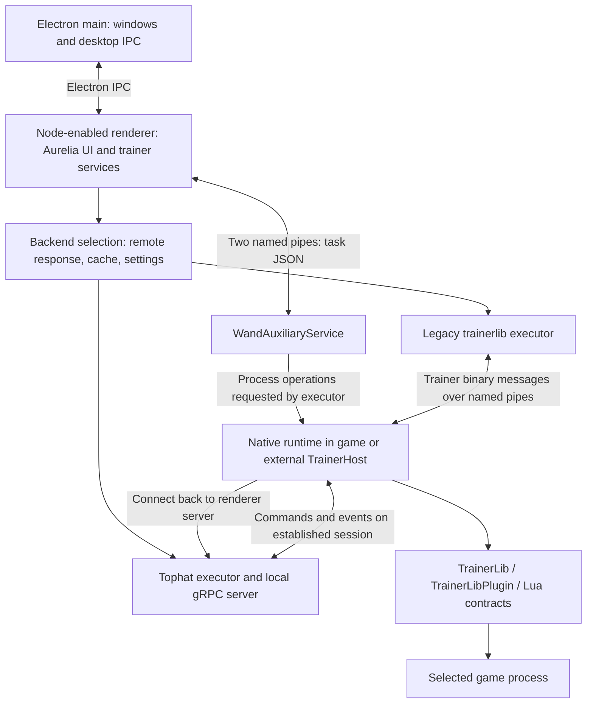

# WAND architecture, build 12.52.0

Evidence labels such as **S1** resolve to original source files and locations in [evidence.md](evidence.md). Arrows below describe code-established call paths; they do not imply that every path was exercised during this investigation.

## Startup and renderer responsibilities

`package.json` selects `index.js` as the Electron main entry point. Main initializes storage/configuration, handles Squirrel lifecycle arguments, acquires a single-instance lock, and schedules `run()` with `app.whenReady()`. `run()` initializes the application window, registers app channels, and loads `index.html` in the packaged build (**S1**).

The main window configuration explicitly sets `nodeIntegration: true`, `contextIsolation: false`, and `webviewTag: true`. The renderer can therefore use Node filesystem, socket, and child-process APIs directly. A universal preload-mediated architecture would be an incorrect model for this build. Other windows have their own configurations; the main window's settings should not be generalized to all webviews.

The renderer bootstrap configures Aurelia features for API access, persisted state, native support, trainer storage, trainer execution, and game installations, then calls `start()` and sets `root/root` as the root (**S2**). This explains why the auxiliary service is a child of renderer PID 2060 rather than of Electron main PID 16248.

Electron main remains responsible for window/tray lifecycle, update integration, app activation, and desktop IPC. Its window-specific handler checks `event.sender.id` against the registered window. The retained DevTools action belongs to this desktop IPC surface (**S1**).

## Native support service

The renderer's support connector creates `Wand\Support_<timestamp>_In` and `_Out` named-pipe servers, then starts `WandAuxiliaryService.exe` with the bare `_Out` name. It sends the second pipe name during initialization and exchanges framed task JSON afterward (**S3**).

The native wrapper exposes process enumeration, DLL injection, remote-thread creation, waiting, file permissions, and other host operations. These task names and arguments are readable in JavaScript even though the managed service's internal type and method names are obfuscated. No support task was invoked during this milestone.

## Backend selection

The executor registry contains `trainerlib` and `tophat` (**S4**). The backend provider resolves a title using the client API wrapper for `POST /v3/trainer/backend`, with `{titleId}` in the body. It caches the response; a failed resolution uses the cached response, or defaults to `tophat` when none exists. A non-`auto` `settings.trainerBackend` overrides the selected backend. Artifact availability also comes from resolution metadata (**S5**, **S15**).

These are client-side branches, not observations of the remote service or the current account's settings. No API request or setting change was made.

## Native runtime placement

Both executor families call a shared host resolver. With `UseExternalHost`, it spawns `TrainerHost_x64.exe` or `TrainerHost_x86.exe` with the game PID and `1000` milliseconds. Otherwise the game PID itself becomes the host PID (**S6**).

The external executable's managed entry point waits for that game PID to exit. The executor subsequently injects the runtime DLL and starts its entry function in the chosen host. The executable filename alone would therefore misidentify where the trainer implementation resides (**N1**, **S7**, **S8**).

## Tophat transport ownership

The renderer creates a gRPC server on `127.0.0.1` with an OS-selected port, publishes it to `%APPDATA%\Wand\service-ports.json`, and waits for a session associated with a generated client ID (**S7**, **S10**). The injected native service receives the port and client ID during startup and connects back to WAND.

The library implements bidirectional `Session`, `TelemetrySession`, and `EventsSession` services, with raw byte serialization and its own payload schemas. It uses insecure gRPC transport credentials on loopback; this fact does not, by itself, establish the authentication properties of session registration. Those checks have not been fully audited.

Passive verification found this registry entry and matching Windows listener:

| Field | Observed value |
|---|---|
| Registry PID | `2060` |
| Registry service/target | `wand_desktop` |
| Registry port | `59371` |
| Listening socket | `127.0.0.1:59371`, owned by PID `2060` |

The port and PID are session-specific. No connection to this application endpoint was initiated by the analysis.

## Storage and secondary components

- Main's config establishes an `App` subdirectory under Electron `userData`, preserving an existing `WeMod` profile in the observed build. Trainer cache configuration appends `trainers` to the resulting storage path (**S1**, **S2**).
- Tophat registry metadata uses `%APPDATA%\Wand\service-ports.json`, while Tophat log configuration uses `%LOCALAPPDATA%\Wand\logs\tophat` (**S1**, **S7**). The inspected log directory yielded no file entries during the passive listing.
- GPU/network utility processes belong to the Electron process tree. Their presence does not identify trainer logic.
- Overlay and capture components have separate paths. They remain outside the initial native call-graph analysis except where value/event forwarding intersects the trainer instance.
