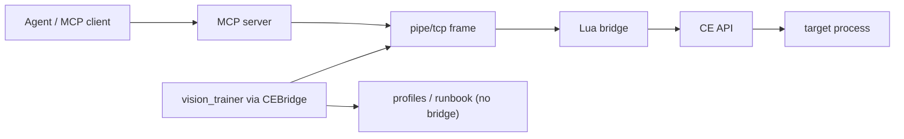
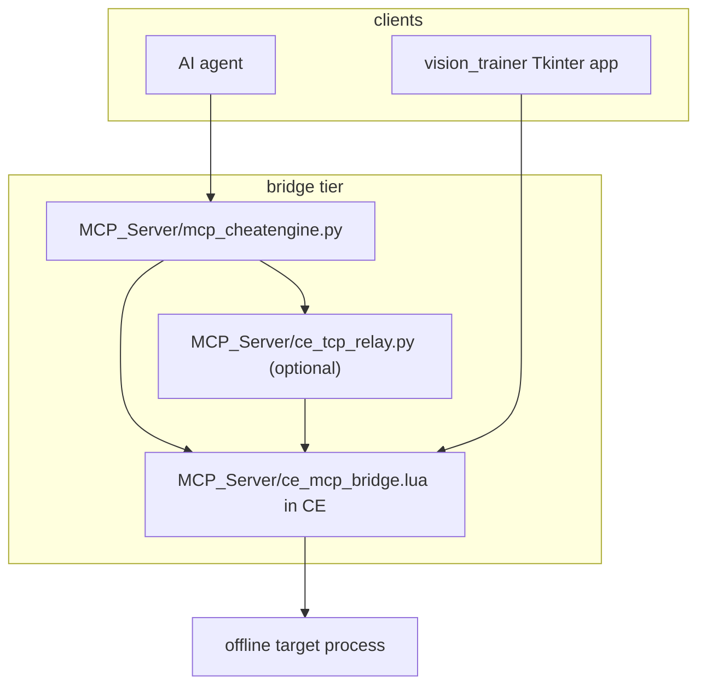

# Architecture Spine — Trainer_Application

## Design Paradigm

Layered broker with a ports-and-adapters transport seam. Two clients (MCP server for agents, `CEBridge` for vision_trainer) speak one framed JSON-RPC protocol to a single Lua broker inside Cheat Engine, which alone touches the CE API and the target process. vision_trainer is additionally layered internally: UI (`main.py`) over headless flow state (`flow.py`) over domain workers (`scan_flow`, `anchor`, `freeze`, `codepatch`) over transport (`ce_client`); persistence (`profiles`, `runbook`) is a bridge-free leaf.

## Invariants & Rules



### AD-1 — Tool pairing across the bridge [ADOPTED]

- **Binds:** all bridge capabilities (176 tools)
- **Prevents:** dispatcher / Method-not-found drift between tiers
- **Rule:** Every tool exists as a global `cmd_<method>` in `ce_mcp_bridge.lua` plus a `commandHandlers[method]` entry plus an `@mcp.tool()` in `mcp_cheatengine.py` with the identical method string; aliases live only in the dispatcher table, never as duplicate handlers; each alias is unique and never collides with a canonical method name.

### AD-2 — Single transport seam [ADOPTED]

- **Binds:** all bridge clients (`mcp_cheatengine.py`, `ce_tcp_relay.py`, `vision_trainer/ce_client.py`)
- **Prevents:** three clients framing or naming the wire incompatibly
- **Rule:** Wire is 4-byte LE length + UTF-8 JSON-RPC with per-side max frame 32 MB (Lua accepts `len < 32 MB`, all Python readers reject `length > 32 MB`, so the largest accepted body is just under 32 MB); pipe name `CE_MCP_Bridge_v99` is identical in all three files; transport selects via `CE_MCP_TRANSPORT=pipe|tcp` (default pipe), `CE_MCP_HOST` default `127.0.0.1`, `CE_MCP_PORT` default `9876`; per-RPC deadline defaults to `CE_MCP_TIMEOUT` `30.0` on TCP paths, and only connection-loss auto-reconnect retries reads — never blind re-sends of mutating writes.

### AD-3 — Main-thread CE execution [ADOPTED]

- **Binds:** all Lua handlers
- **Prevents:** crash-prone CE API calls from worker threads
- **Rule:** The pipe worker thread owns blocking pipe I/O only; every `executeCommand` runs on the main thread via `thread.synchronize`; no handler spawns a CE-touching thread.

### AD-4 — Response envelope [ADOPTED]

- **Binds:** all bridge capabilities and clients
- **Prevents:** client-side result-parsing branches diverging
- **Rule:** Lua returns JSON-RPC `result`|`error`; Python unwraps to `{success:true,...}` or `{success:false,error,error_code}`; addresses serialize as hex via `toHex` and parse as string-or-int; list results paginate as `{total,offset,limit,returned}` with limit capped at 10000; the `error_code` vocabulary is closed (`NO_PROCESS`, `CE_API_UNAVAILABLE`, `INVALID_PARAMS`, `NOT_FOUND`, `DBK_NOT_LOADED`, `PERMISSION_DENIED`, `INTERNAL_ERROR`) and clients treat unknown codes as `INTERNAL_ERROR`, never crashing.

### AD-5 — Global handlers under the Lua local limit [ADOPTED]

- **Binds:** all Lua code
- **Prevents:** CE load failure from local-slot exhaustion past 200 locals
- **Rule:** All `cmd_*` handlers and shared tables are global, never `local`; new code carries a mergeable `UNIT-NN` marker; helpers stay `local` only when not registered per-command.

### AD-6 — Cleanup ownership on reload [ADOPTED]

- **Binds:** all long-lived bridge resources
- **Prevents:** reload leaks and zombie breakpoints/watches/scans
- **Rule:** Every long-lived resource (HW breakpoint, DBVM watch, scan object, MDL map) registers in `cleanupZombieState`, torn down by `StopMCPBridge` before `StartMCPBridge`; re-executing the Lua script is always safe.

### AD-7 — Anchor ladder order [ADOPTED]

- **Binds:** `anchor.py`, `scan_flow.py`, `profiles.py` export
- **Prevents:** two builders inventing incompatible re-location orders
- **Rule:** Re-location resolves `module_offset` → `signature` → `pointer_chain` → `rescan` callback; ambiguous (non-unique) signatures refuse that rung and fall through to the next rather than guessing or aborting the ladder; a validated pointer chain means `read_pointer_chain`/`validate_pointer_chains` returned a non-empty `matches` set; raw `last_address` is never trusted under ASLR and exports stale-last.

### AD-8 — Mutation ownership with restore [ADOPTED]

- **Binds:** `freeze.py`, `codepatch.py`, `main.py`, `flow.py`
- **Prevents:** divergent freeze/patch lifecycles leaving targets dirty
- **Rule:** `FreezeWorker`/`codepatch` own all writes, capture the original value/bytes once before the first write, and `restore_on_exit` runs via `FlowState.shutdown` plus `atexit` (registry restore-all, patch byte-restore, breakpoint clear, best-effort); drafts replace wholesale and promote only on explicit user confirmation; force-kill residue (in-memory originals lost, `atexit` never runs) has no automatic owner — re-attach must re-resolve via the AD-7 ladder and explicitly re-freeze/re-patch, never assume the old address or value.

### AD-9 — Safety gates [ASSUMPTION carried — needs user ratification]

- **Binds:** all
- **Prevents:** safety posture diverging per unit
- **Rule:** Offline-games-only scope; `run_command`/`shell_execute` require `CE_MCP_ALLOW_SHELL=1` (default unset); arbitrary Lua execution (`evaluate_lua`, threaded/queued Lua) is trusted-code-only by convention and ungated by env; TCP relay binds loopback/trusted interfaces only; CE setting `Query memory region routines` stays disabled; hardware DR0–DR3 breakpoints and DBVM watches preferred over `0xCC` software breakpoints.

### AD-10 — 64-bit branching [ADOPTED]

- **Binds:** all Lua handlers touching sized data
- **Prevents:** 32/64-bit shape divergence
- **Rule:** Handlers branch on `targetIs64Bit()` and use `readPointer()` for pointer-sized data; responses carry `arch` where shape depends on it.

### AD-11 — Dependency direction [ADOPTED]

- **Binds:** all modules (see diagram above)
- **Prevents:** layer-skipping calls that bypass the broker or the flow state
- **Rule:** Agent traffic flows only through MCP server → pipe/tcp → Lua bridge → CE API → target; vision_trainer's UI (`main.py`) drives the bridge exclusively through the headless `FlowState` (which owns attach, confirm/promote, and shutdown) and reaches the wire only via `CEBridge`, never the CE API directly; `profiles`/`runbook` have no bridge dependency.

## Consistency Conventions

| Concern | Convention |
| --- | --- |
| Naming (entities, files, interfaces, events) | `cmd_<snake_method>` Lua globals keyed verbatim in dispatcher; `@mcp.tool() <same_name>` in Python; `UNIT-NN` section markers mergeable |
| Data & formats (ids, dates, error shapes, envelopes) | AD-4 envelope; `error_code` in (`NO_PROCESS`, `CE_API_UNAVAILABLE`, `INVALID_PARAMS`, `NOT_FOUND`, `DBK_NOT_LOADED`, `PERMISSION_DENIED`); RUNBOOK append-only per-game Markdown, profiles JSON `schema:1` per-game with wholesale-replaced drafts |
| State & cross-cutting (mutation, errors, logging, config, auth) | Config via env (`CE_MCP_TRANSPORT/HOST/PORT/TIMEOUT/ALLOW_SHELL`); Python `debug_log()` to stderr only, never stdout; attach checks use side-effect-free `get_opened_process_id`, never `get_process_info` (reinitializes symbols) nor bridge reload as a health check |

## Stack

| Name | Version |
| --- | --- |
| Python | >= 3.10 (floor expires 2026-10-31 with 3.10 EOL — plan bump to >= 3.11) |
| mcp (Python SDK, FastMCP v1 line) | >= 1.28, < 2 (v2 removes `mcp.server.fastmcp`; re-pin only after code migration) |
| Cheat Engine + Lua bridge host | 7.6 tested baseline (7.7 released May 2026 — compat check owed) |
| Tkinter | stdlib (bundled with Python) |
| pywin32 (named-pipe client) | >= 306 |
| pytest (offline `-m "not live"` vs live `-m live` harness gate) | per `vision_trainer/pytest.ini` |

## Structural Seed



```text
MCP_Server/        # bridge tier: server + Lua broker + relay + tests
  mcp_cheatengine.py   # 176 @mcp.tool() + transport clients + stdio guard
  ce_mcp_bridge.lua    # 176 cmd_ globals + dispatcher + PipeWorker
  ce_tcp_relay.py      # pipe-to-TCP relay for WSL/remote
vision_trainer/    # app tier: wizard UI over headless flow + domain workers
  main.py / flow.py    # UI wizard / headless state machine + shutdown
  scan_flow.py / anchor.py / freeze.py / codepatch.py  # domain workers
  profiles.py / runbook.py / factory.py                # bridge-free persistence
  ce_client.py     # sole bridge transport
AI_Context/        # per-command reference + safety guides (read before tooling)
```

## Deferred

- Per-tool parameter schemas and scan-option catalogs: owned by `AI_Context/MCP_Bridge_Command_Reference.md`, not fixed here.
- vision_trainer LLM extraction/verification providers and screenshot pipeline: leaf choices under `llm_client.py`/`screenshot.py`, no cross-unit divergence risk.
- Live-harness target design and per-game cheat recipes: per-game data in profiles/RUNBOOKs, decided at use time.
- CI packaging and distribution (no build/linter harness for the bridge): no decision until a harness exists.
- AD-9 ratification: user to confirm the `[ASSUMPTION]` safety gates hold as stated.
- Operational envelope gaps owed before parallel builds: OS/transport matrix (Windows pipe vs relayed TCP), DBVM on/off posture, `%APPDATA%/VisionTrainer` path ownership, and bridge observability (stderr-only debug log, no stdout) as explicit conventions or open questions.
